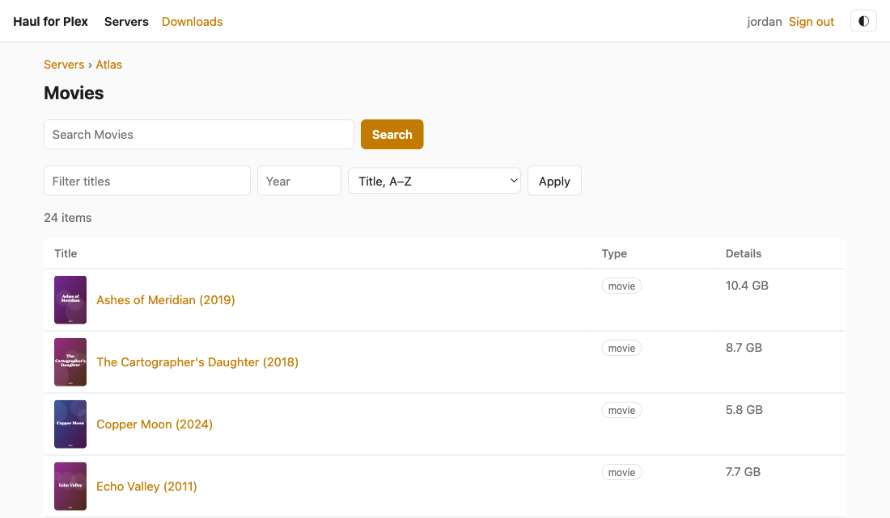
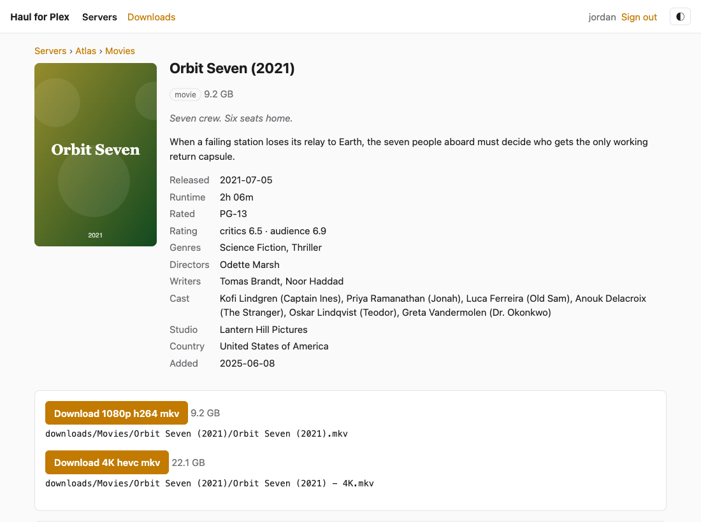
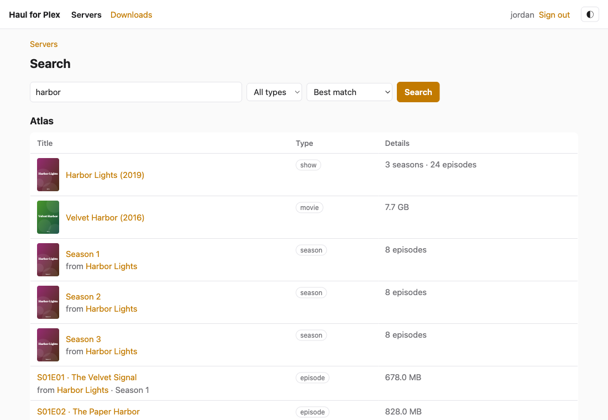
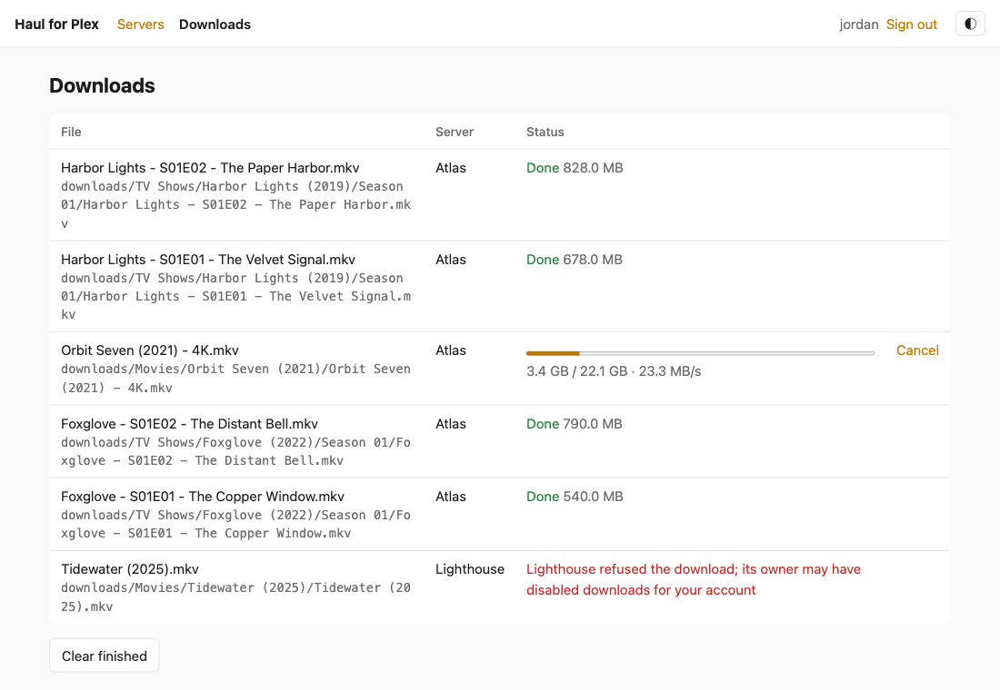
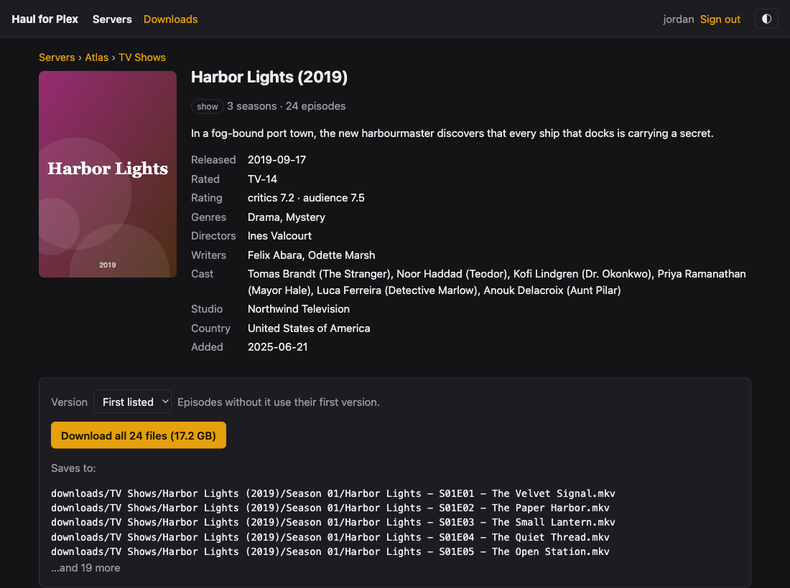

# Haul for Plex

A small tool for downloading media from the Plex servers your account can
access, saved into a clean Plex-style folder layout. Use it from the command
line or through a simple web interface.

- Sign in with your Plex account (no password handling; you approve it on plex.tv)
- List and search every server you have access to, owned or shared
- Download movies, episodes, whole seasons or whole shows
- See what you already have: other servers are compared with your own, so
  you can spot missing films and episodes, and better copies of ones you have
- Interrupted downloads resume where they left off, and retry by themselves
  when a server drops
- The web download queue can be paused and resumed, and survives restarts
- Files are renamed into a layout Plex, Jellyfin and friends understand
- One static binary, or a ~40 MB Docker image

## Screenshots

The web interface (`haul serve`), shown here with made-up media from
`haul-demo`:











## Install

**Prebuilt binary:** download the archive for your platform from the
[releases page](https://github.com/jhofker/haul-for-plex/releases) (Linux,
macOS and Windows).

**From crates.io:** `cargo install haul-for-plex` (installs `haul`).

**From source:** `cargo install --path crates/haul-cli`.

**Docker:** `docker pull ghcr.io/jhofker/haul-for-plex` (`latest` is the newest
release; pin `0.2` or `0.2.0` to stay on a version)

## Command line

```console
$ haul login                       # prints a link; approve it in your browser
$ haul servers                     # your servers and how each is reachable
$ haul libraries "Home"            # server names can be abbreviated
$ haul ls "Home" movies            # a library, or any item key
$ haul ls "Home" movies --sort added:desc --filter lantern --year 2012
$ haul search "lantern keeper"      # across all your servers
$ haul download "Home" 84521       # a movie, episode, season or show key
$ haul download "Home" 100583 --parallel 4 --dry-run
$ haul download "Home" 84521 --version 4k   # pick a version
```

Add `--json` to any command for machine-readable output. Keys come from `ls`
and `search`.

## Compare with your own library

Haul can tell you which titles on a friend's server you already have. The
servers you own count as your library (choose others with `haul my-library`);
items elsewhere are marked **Have it**, **Upgrade** (theirs has a higher
resolution), **Missing**, or, for shows and seasons you have part of, how many
episodes are missing.

```console
$ haul ls "Friend" movies --compare        # adds a YOUR LIBRARY column
$ haul ls "Friend" "tv shows" --status missing
$ haul search "harbor" --compare           # leaves out your own servers
$ haul download "Friend" 100583 --only-missing   # just the episodes you lack
$ haul my-library                          # which servers count, and what's on them
$ haul my-library "Home" "Archive"         # count these instead
$ haul my-library --owned                  # back to every server you own
```

Titles are matched by their IMDb, TMDB and TVDB ids (and Plex's own ids),
falling back to title and year. Your library is read once and saved for ten
minutes, so repeated commands stay quick; `haul my-library --refresh` reads it
again.

In the web interface the same badges appear in library, show and search lists,
with a filter for them, and a show or season you have part of gets a
**Download missing episodes** button. Your own servers are hidden from the
Servers page and from searches across all servers, since downloading from
yourself is rarely wanted; links on those pages bring them back. Choose which
servers count as your library at the bottom of the Servers page.

Run `haul download --help` for all options. Existing files of the right
size are skipped; a file of a different size is only replaced with `--force`.

## Where files go

```text
<movies-dir>/The Lantern Keeper (2012)/The Lantern Keeper (2012).mkv
<tv-dir>/Harbor Lights (2019)/Season 02/Harbor Lights - S02E05 - The Long Tide.mkv
```

Set the folders with `--movies-dir` / `--tv-dir` or the environment variables
below. Without them, files go under `./downloads/Movies` and
`./downloads/TV Shows`. Downloads are written as `<name>.part` and renamed when
complete, so a half-finished file never looks finished.

## Web interface

```console
$ haul serve                       # http://127.0.0.1:8080
$ haul serve --bind 0.0.0.0:8080 --password 'something long'
```

Sign in with Plex in the browser, then browse servers and libraries, search,
and press **Download**. Library, episode and search lists can be filtered by
title, year or type and sorted by title, year, date added, release date or
rating. The Downloads page shows live progress and lets you pause, resume or
cancel each file, or pause and resume everything (or everything from one
server). Pausing frees the download slot for the next file and keeps the
partial file.

The queue is saved to `queue.json` next to the config file, so a restart or
`docker stop` picks up where it left off: unfinished files resume from their
partial files and paused ones stay paused. If a server drops or answers with a
temporary error, its files show as waiting for that server and are retried on
their own (after 5 seconds, then less often, up to every 5 minutes) while other
servers' files keep going. Lost access, a removed item or a full disk fail
straight away; press Retry once it's fixed. It is designed for a single user.

If you listen beyond localhost, set a password. It is asked for with HTTP basic
auth (any username). Do not expose the port to the internet without a reverse
proxy providing HTTPS.

## Docker

```yaml
services:
  haul:
    image: ghcr.io/jhofker/haul-for-plex:latest
    ports: ["8080:8080"]
    environment:
      HAUL_WEB_PASSWORD: change-me
    volumes:
      - ./config:/config        # sign-in, settings and the download queue
      - /path/to/movies:/movies # your movies folder
      - /path/to/tv:/tv         # your TV folder
    # user: "1000:1000"         # write files as this user instead of root
```

Open <http://localhost:8080> and sign in. To use the CLI in the image:
`docker compose run --rm haul servers`.

## Configuration

| Environment variable | Meaning | Default (Docker) |
|---|---|---|
| `HAUL_CONFIG_DIR` | where `config.json` (token, client id) and the web download queue live | OS config dir (`/config`) |
| `HAUL_MOVIES_DIR` | movies folder | `./downloads/Movies` (`/movies`) |
| `HAUL_TV_DIR` | TV folder | `./downloads/TV Shows` (`/tv`) |
| `HAUL_BIND` | web interface address | `127.0.0.1:8080` (`0.0.0.0:8080`) |
| `HAUL_WEB_PASSWORD` | web interface password | none |

The config file holds your Plex token and is only readable by its owner.

## Notes

- A server owner can disable downloads for people they share with. Those
  servers refuse the download and Haul reports it; it does not try to
  work around the setting.
- `haul download` retries a file up to 5 times when the server drops, times
  out or answers with a temporary (5xx) error, waiting longer each time and
  reconnecting, since the best connection may have changed. Change that with
  `--retries N`; `--retries 0` turns it off.
- When an item has several versions (for example 1080p and 4K), the first is
  used unless you choose: `--version 2` (numbered as in `ls`) or
  `--version 4k` / `1080p` / `720p` / `sd`. For a season or show, episodes that
  lack the requested version use their first one. Versions other than the first
  are saved as `Movie (2023) - 4K.mkv` so both can sit side by side. In the web
  interface a movie or episode with several versions has a download button per
  version, and seasons and shows have a version picker.

## Development

```console
$ cargo test --workspace
$ cargo clippy --workspace --all-targets -- -D warnings
```

The workspace has three crates: `haul-core` (Plex clients, naming, downloader),
`haul-for-plex` (the `haul` binary, in `crates/haul-cli`) and `haul-web` (the web interface).

Releasing: bump `version` in the workspace `Cargo.toml` and the two `haul-*`
dependency versions beside it, commit, then push a `vX.Y.Z` tag. That builds
the binaries and Docker images and publishes the crates to crates.io.

To try the web interface (or take screenshots) without a Plex account, run
`cargo run -p haul-demo`. It starts the real interface against fake servers
with made-up movies and shows. The `haul-demo` crate is `publish = false`:
it is not part of the `haul` binary, the Docker image or crates.io.

## Disclaimer

Haul for Plex is an independent project. It is not affiliated with, endorsed
by, or sponsored by Plex, Inc. Plex is a trademark of Plex, Inc.
